# 🔥 Fire Safety Platform

An end-to-end platform for selling fire-safety equipment and running fire-safety services: an online **store**, a
**B2B quote desk**, **service bookings** with technicians in the field, **AMC** (annual maintenance) contracts,
**GST invoicing**, and **automatic refill / inspection reminders** backed by a digital **equipment passport**.

| App | What it is | Stack | Default port |
|---|---|---|---|
| [`client/`](client) | Customer storefront and account area | React 18, Vite, TypeScript, Tailwind | `5173` |
| [`admin/`](admin) | Staff console (admins, sales, accountants, technicians) | React 18, Vite, TypeScript, Tailwind, Recharts | `5174` |
| [`server/`](server) | REST API, background jobs, PDF generation | Node 18+, Express, TypeScript, Mongoose | `5000` |

> **Diagrams** in this file are [Mermaid](https://mermaid.js.org/): GitHub, GitLab, VS Code (with a Mermaid extension)
> and most Markdown viewers draw them automatically.

---

## Contents

1. [Overview](#1-overview)
2. [Features](#2-features)
3. [Project architecture](#3-project-architecture)
4. [Repository structure](#4-repository-structure)
5. [Data model](#5-data-model)
6. [Key flows](#6-key-flows)
7. [Roles and permissions](#7-roles-and-permissions)
8. [Security](#8-security)
9. [Deployment](#9-deployment)
10. [CI/CD](#10-cicd)
11. [Getting started](#11-getting-started)
12. [Configuration](#12-configuration)
13. [Scripts and testing](#13-scripts-and-testing)
14. [Operations checklist](#14-operations-checklist)
15. [Troubleshooting](#15-troubleshooting)
16. [Known limitations and roadmap](#16-known-limitations-and-roadmap)

---

## 1. Overview

### System overview

Three apps talk to one API. The API is the only thing that touches the database and the third-party services.

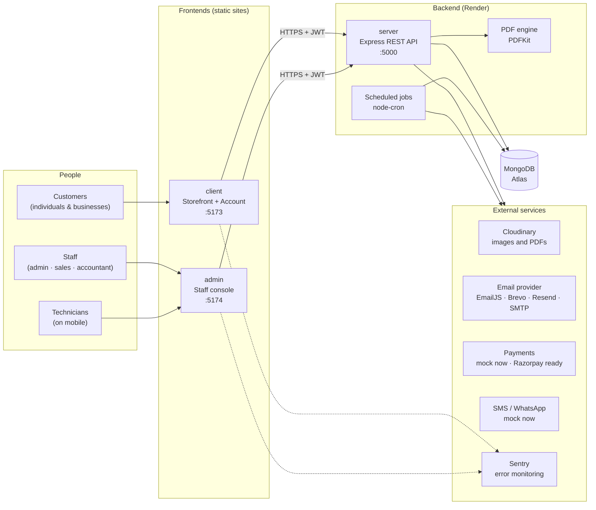

### How the business fits together

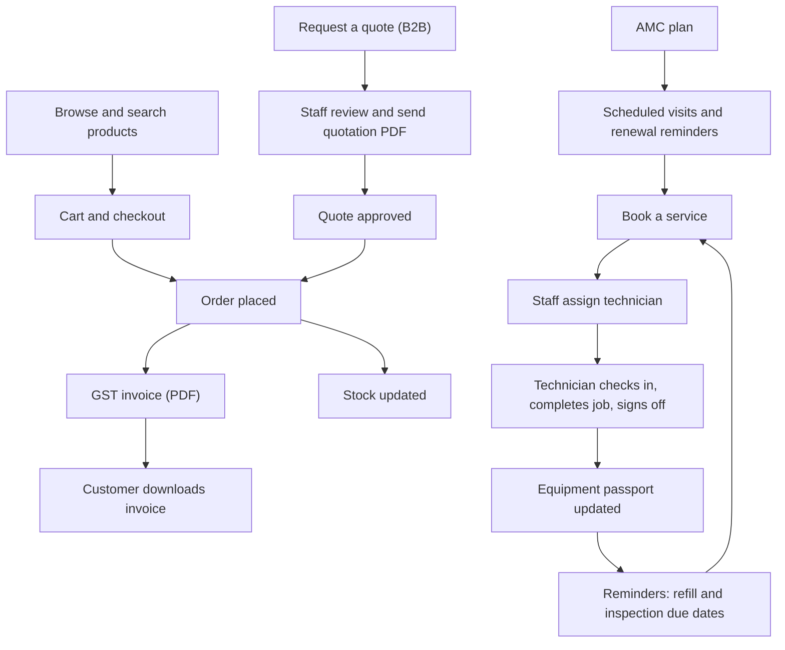

---

## 2. Features

### Customer storefront (`client/`)

| Area | What you get |
|---|---|
| **Catalog** | Categories, filters, sorting, pagination, product pages with gallery, specs, reviews, related items |
| **Search** | Live typeahead in the navbar: partial words, SKU and brand matching, photos, price and stock, scroll to load more, keyboard control (`/` focuses it) |
| **Cart and checkout** | Quantity edit, coupons, saved or new address with Indian phone / pincode / GSTIN validation, COD or test payment, live GST summary |
| **Account** | Orders (with cancel), quotes, equipment register, service history, **invoices with PDF download**, addresses, notifications, profile |
| **Services** | Service catalog, booking with slot capacity, multi-product **B2B quote form** with product search and photos |
| **Equipment passport** | Public, QR-friendly page per extinguisher with refill and inspection history (owner contact details are never shown) |
| **Auth** | Register (individual or business), **email OTP verification**, login, forgot / reset password |
| **Content and SEO** | Blog, gallery, FAQ, contact, about, legal pages, per-page titles / meta / Open Graph / JSON-LD |
| **Look and feel** | Liquid-glass and tactile (skeuomorphic) design system, light and dark mode, reduced-motion and reduced-transparency fallbacks |

### Staff console (`admin/`)

| Area | What you get |
|---|---|
| **Dashboard** | Revenue, orders, services today, AMC renewals due, low stock, technician load (charts) |
| **Catalog** | Products, categories, coupons, banners, gallery, FAQs, blog |
| **Sales** | Orders lifecycle, quotes (review, PDF, convert to order), invoices (PDF download), customers (CRM) |
| **Service operations** | Bookings and technician assignment, AMC contracts, equipment records, technician **My jobs** mobile flow (GPS check-in, report, signature, photos) |
| **Governance** | Staff and roles, tamper-evident **audit log**, company settings, reports with CSV export |
| **Global search** | `Ctrl/⌘ + K` across orders, customers, bookings and products (only shown to roles allowed to read them) |

### Backend (`server/`)

REST API under `/api` (auth, products, orders, quotes, invoices, services, bookings, equipment, AMC, reviews, CMS,
notifications, reports, audit logs, uploads), five scheduled jobs, PDF generation (quotes, invoices, service
reports), email in four providers, sealed audit chain, request logging (Pino), and graceful shutdown.

---

## 3. Project architecture

### Backend layers

Every request passes through the same pipeline. Business rules live in **services**, not in routes.

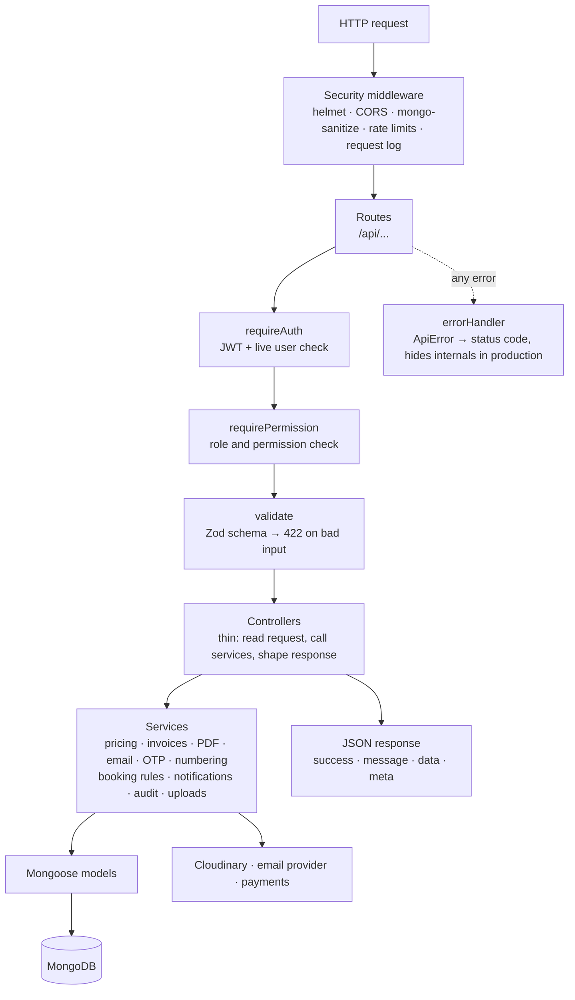

| Folder | Responsibility |
|---|---|
| `routes/` | URL → middleware chain → controller. One file per resource |
| `middleware/` | `auth`, `rbac`, `validate`, `requestLogger`, `errorHandler` |
| `controllers/` | Parse request, call services, return the standard response shape |
| `services/` | Business logic (pricing, GST, invoices, PDFs, email, OTP, numbering, booking rules, audit, uploads) |
| `models/` | Mongoose schemas and indexes |
| `validators/` | Zod schemas, one per write endpoint |
| `jobs/` | `node-cron` jobs (reminders, AMC expiry, low stock, abandoned carts, cleanup) |
| `utils/` | `ApiError`, pagination, IST date maths, TTL cache, graceful shutdown, JWT helpers |
| `config/` | `env` (single source of environment variables), `db`, `logger`, `permissions` |

### Frontend architecture (client and admin)

Both apps follow the same shape: pages are lazy-loaded, server state lives in TanStack Query, and one axios
instance handles tokens, refresh, timeouts and the "server is waking up" notice.

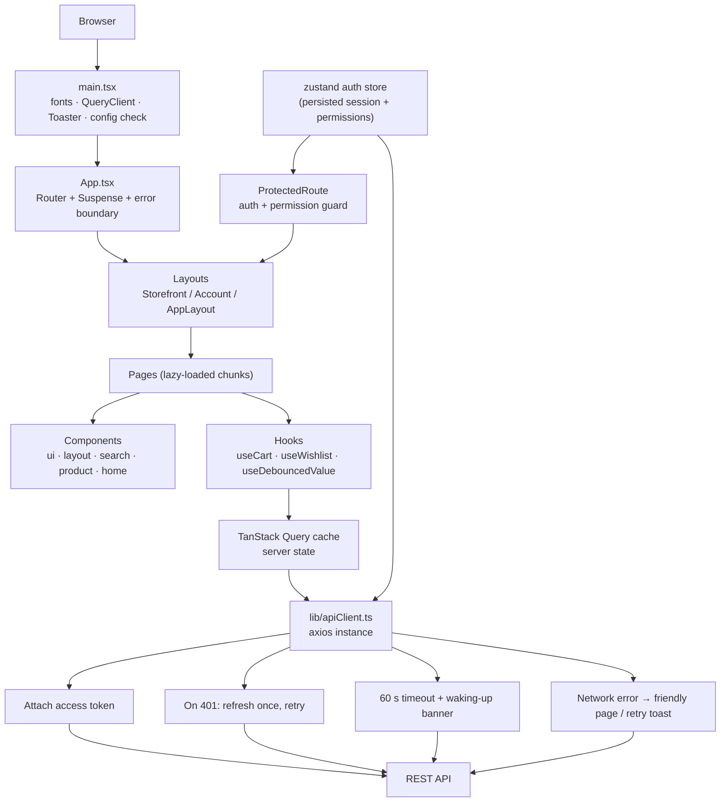

---

## 4. Repository structure

```text
fire-safety-platform/
├── client/                      # Customer storefront
│   └── src/
│       ├── components/          # ui (Button, Card, Modal, forms) · layout (Header, Footer) · search · product · home · seo
│       ├── hooks/               # useCart, useWishlist, useDebouncedValue, useServices ...
│       ├── lib/                 # apiClient, validators, format (₹ and IST dates), downloadFile, theme
│       ├── pages/               # Home, products, cart, checkout, account, services, blog, auth, static, errors
│       ├── routes/              # ProtectedRoute, lazyPages (code splitting + hover preload)
│       ├── store/               # auth store, server-status store
│       └── index.css            # design tokens + glass / tactile surface classes
├── admin/                       # Staff console (same structure) + lib/navConfig (menu, permissions, home route)
├── server/
│   ├── src/
│   │   ├── config/              # env, db, logger, permissions (roles → permissions)
│   │   ├── controllers/  routes/  validators/  middleware/
│   │   ├── models/              # 23 Mongoose models
│   │   ├── services/            # pricing, invoice, pdf, email, otp, upload, audit, booking rules ...
│   │   ├── jobs/                # cron: reminders, AMC expiry, low stock, carts, cleanup
│   │   ├── utils/               # pagination, ttlCache, istTime, gracefulShutdown, seed ...
│   │   └── server.ts            # bootstrap, shutdown, process safety
│   ├── tests/                   # Vitest + Supertest (real MongoDB)
│   └── scripts/                 # loadtest.md (autocannon)
├── .github/workflows/ci.yml     # lint · typecheck · test · build
├── CHANGES.md                   # review-pass notes
└── README.md
```

---

## 5. Data model

Main collections and how they relate (field lists are trimmed to what matters).

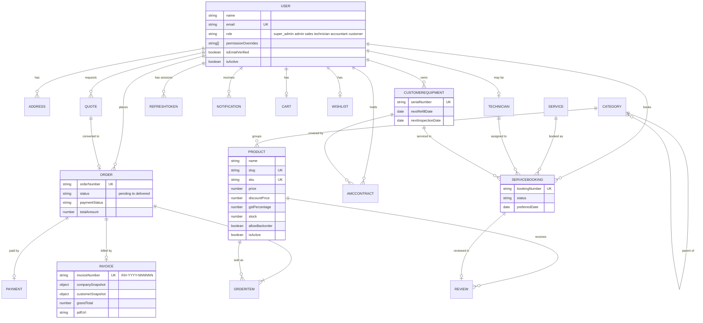

Supporting collections: `AuditLog` (sealed hash chain), `LoginThrottle` (brute-force counters, hashed keys),
`Setting` (company details, public site settings), `Coupon`, `BlogPost`, `Banner`, `GalleryItem`, `Faq`.

---

## 6. Key flows

### 6.1 Registration, login and sessions

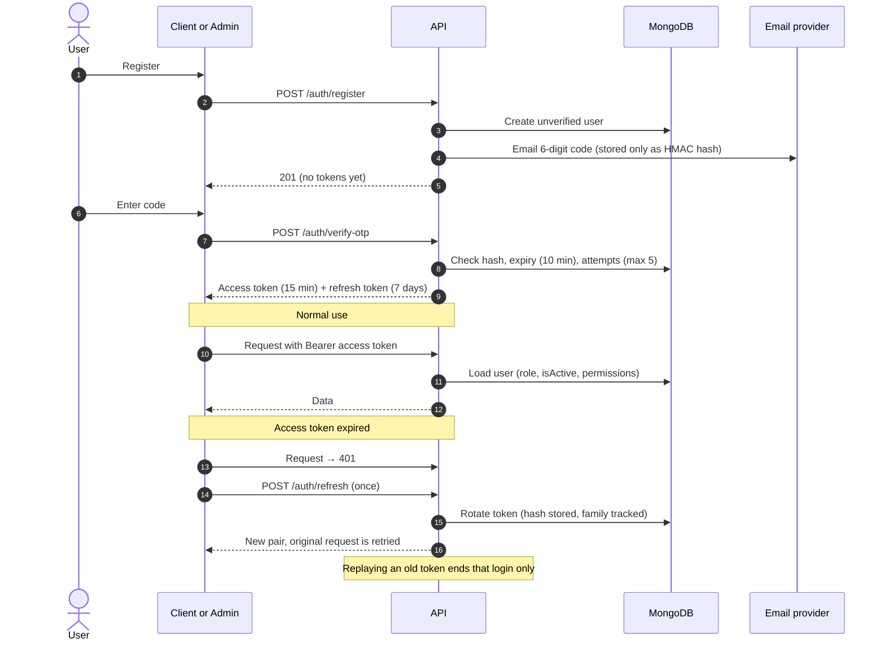

### 6.2 Checkout

Stock is protected by **atomic conditional updates** (no oversell, no transactions needed), and a failed checkout
leaves stock and coupon usage unchanged.

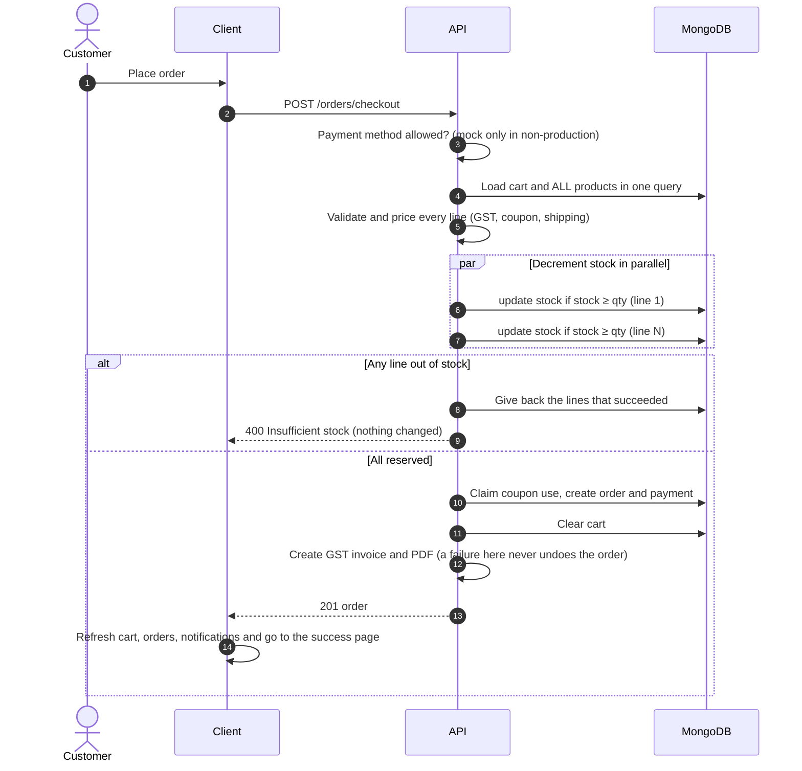

### 6.3 Product search

```mermaid
flowchart LR
    T["Typing in the box"] --> D["Wait 250 ms for a pause"]
    D --> Q["GET /api/products/search<br/>q, page, limit"]
    Q --> P["Clean the query<br/>trim · max 100 chars · max 5 words"]
    P --> F["Every word must match<br/>name · SKU · brand · short text<br/>(partial, any case, escaped)"]
    F --> S["Score and sort<br/>exact SKU › name starts with › word starts › contains › brand<br/>in-stock bonus"]
    S --> R["8 results per page<br/>+ total, photo, price, stock"]
    R --> UI["Dropdown: highlight matches,<br/>scroll for the next page"]
    UI --> CH{"Choice"}
    CH -- "click / Enter on row" --> PD["Open product page"]
    CH -- "Enter on text" --> LIST["/products?q=… (same matching)"]
```

### 6.4 Invoice PDF download

Invoices are downloaded through the API (with the person's login), so the file always saves as a real
`INV-2026-000001.pdf`.

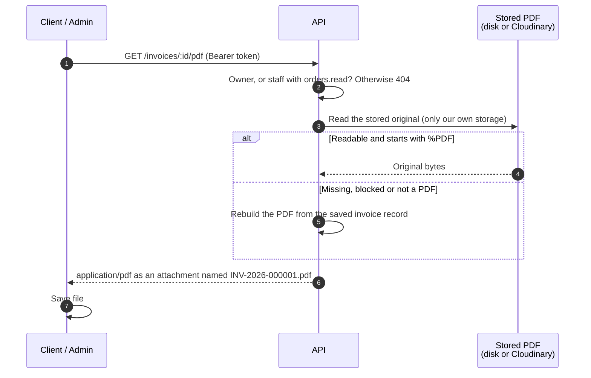

### 6.5 Status lifecycles

**Order**

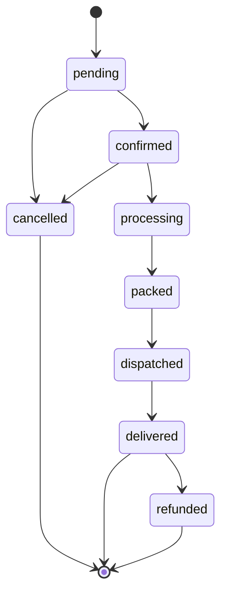

**Service booking** (rules in `services/bookingRules.ts`)

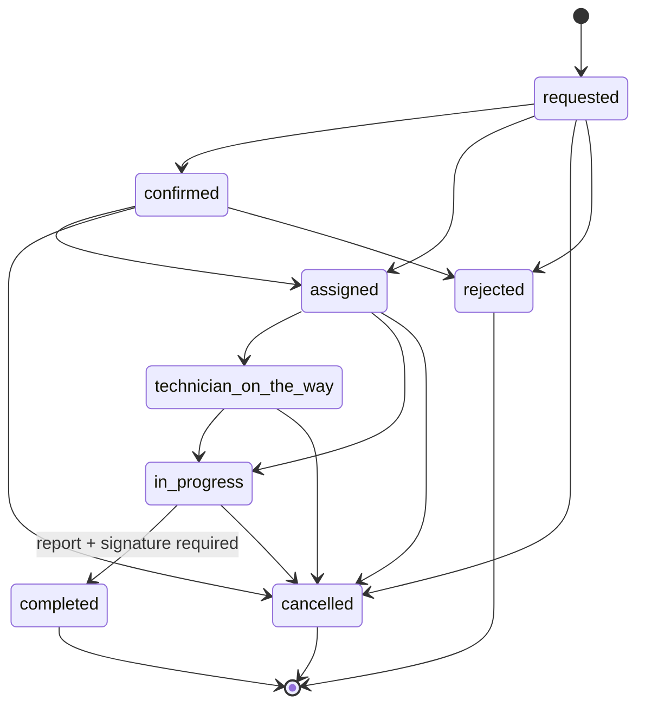

**B2B quote**

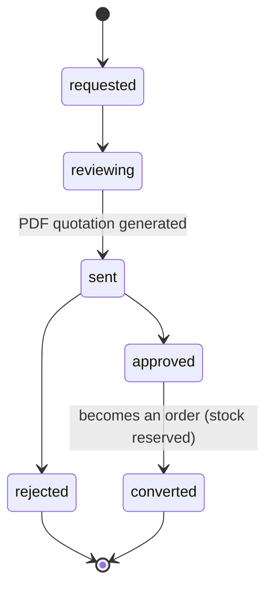

### 6.6 Technician job flow

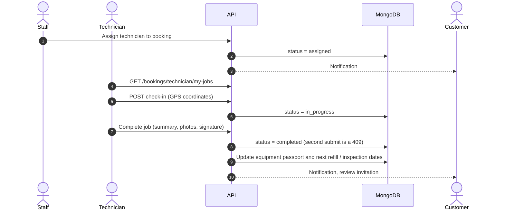

### 6.7 Email providers

Sending always goes through one function. A failed send is reported as `{ sent: false }`, never thrown, and
callers use that result (for example the staff invite and the OTP screen).

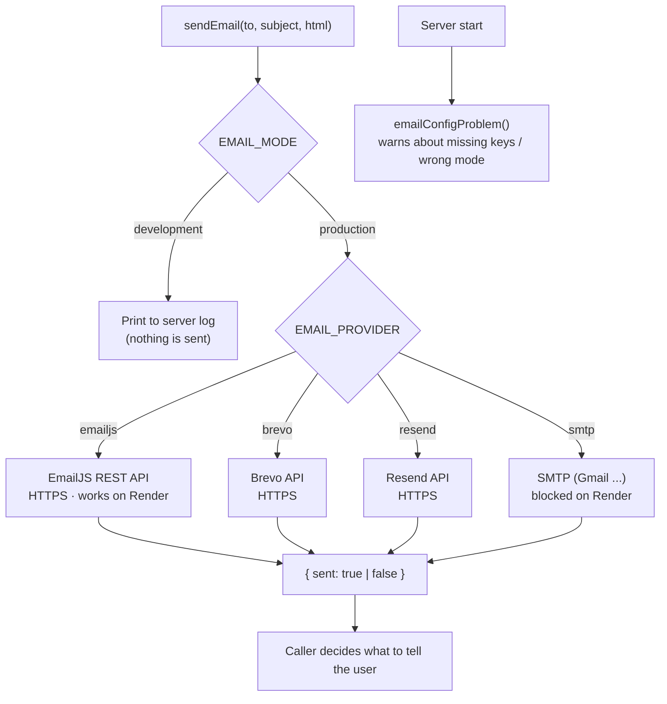

### 6.8 Scheduled jobs

| Job | Default schedule | What it does |
|---|---|---|
| Equipment reminders | `0 9 * * *` | Refill / inspection milestones (30, 15, 7, 1 days, today, overdue), each sent once |
| AMC expiry scan | `0 9 * * *` | Flags `expiring_soon` / `expired`, reminders |
| Low stock scan | `0 8 * * *` | Notifies staff of products at or below their threshold |
| Abandoned carts | `0 10 * * *` | Reminder for carts left behind |
| Notification cleanup | `0 3 * * 0` | Weekly housekeeping |

A failing job is logged and never stops the server. Render's free plan sleeps when idle, so keep it awake with an
uptime pinger (see [Deployment](#9-deployment)) or the jobs will not run.

---

## 7. Roles and permissions

Six roles. Every protected route checks a **specific permission** (for example `products.update`); the frontend only
hides menu items, the API is the real authority. Per-user overrides are stored in `permissionOverrides`.

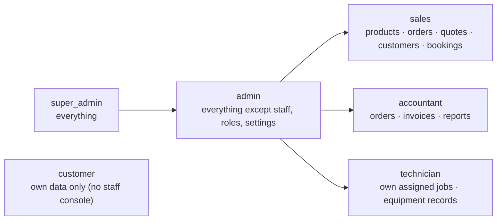

| Role | Can do | Cannot do |
|---|---|---|
| `super_admin` | Everything, including staff, roles and company settings | , |
| `admin` | All daily operations | Manage staff, roles or settings |
| `sales` | Catalog read, orders, quotes, customers, bookings | Settings, staff, audit |
| `accountant` | Orders, invoices, reports | Catalog edits |
| `technician` | Assigned jobs (check-in, report, photos), equipment records | Catalog, orders, other technicians' jobs |
| `customer` | Own orders, quotes, invoices, equipment, bookings, profile | Anything in the staff console |

The exact matrix is in [`server/src/config/permissions.ts`](server/src/config/permissions.ts).

After signing in, staff land on the right page for their role (technicians go to **My jobs**), and the dashboard
makes no report requests for roles without `reports.read`.

---

## 8. Security

| Topic | How it is handled |
|---|---|
| **Tokens** | Short-lived access token (15 min). Refresh tokens are stored only as hashes, rotated on every use, grouped in families, and revoked on logout; reusing an old one ends that login only |
| **Passwords** | bcrypt; staff get a one-time set-password link (24 h), never a password by email |
| **Brute force** | Per-account and per-IP counters (hashed keys), lockout that cannot be used to lock out the owner, owner alerted by email; unknown emails are throttled too |
| **Email OTP** | CSPRNG code, HMAC hash stored, constant-time compare, 10-minute expiry, 5 attempts, resend cooldown plus rate limit |
| **Account enumeration** | Same answer for unknown email and wrong password; "forgot password" answers the same either way and sends the email in the background |
| **Authorization** | Permission checked on every route; customers see only their own data; someone else's invoice looks like it does not exist (404) |
| **Input** | Zod validation (422), Mongo operator sanitising, regex escaping in all searches, length and word-count limits |
| **Uploads** | File type read from the file's content (not its name), HTML/script refused, path traversal blocked, hardened headers on served files |
| **Payments** | `mock` is accepted **only** when `PAYMENT_MODE=mock` and `NODE_ENV` is not `production`; checked in the validator and again in checkout |
| **Audit log** | Staff actions in a tamper-evident hash chain (`GET /api/audit-logs/verify`), with real client IP and user agent |
| **Transport** | `helmet`, strict CORS, `TRUST_PROXY` for the correct client IP, rate limits on `/auth` and OTP resend |
| **Operations** | Graceful shutdown (finish requests, close DB, 10 s hard stop), unhandled errors logged, Sentry optional |

---

## 9. Deployment

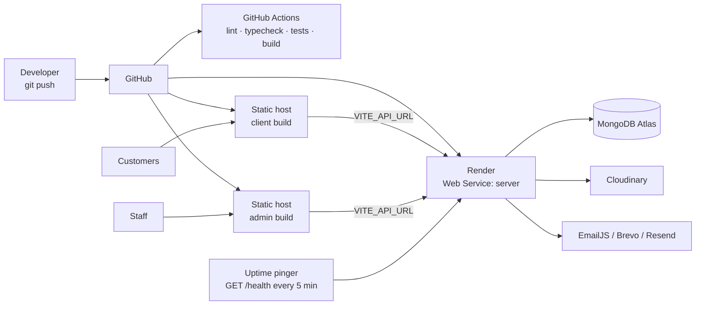

Checklist for a real deployment:

- **Same region** for the Render service and the Atlas cluster (for example Mumbai or Singapore) to cut query latency.
- Set **`NODE_ENV=production`** and **`PAYMENT_MODE`** explicitly on the server.
- Set **`VITE_API_URL`** (for example `https://your-api.onrender.com/api`) as a build variable for **both** frontends.
  Their builds stop with a clear message if it is missing, so a live site can never quietly call `localhost`.
- Set `EMAIL_MODE=production`, `EMAIL_PROVIDER` and that provider's keys. SMTP ports are blocked on Render.
- Add an **uptime pinger** (for example UptimeRobot) on `https://<service>.onrender.com/health` every 5 minutes so the
  free service stays awake and the cron jobs run.
- Free Render services need about 50 s to wake from sleep; the frontends show a "server is waking up" notice and wait
  up to 60 s.

---

## 10. CI/CD

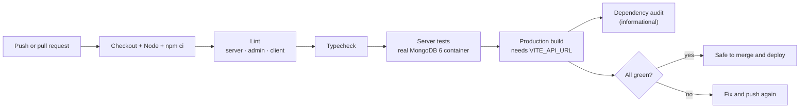

The build step reads `VITE_API_URL` from a repository variable of the same name (Settings → Secrets and variables →
Actions → Variables) and falls back to a placeholder, because CI only proves the code compiles.

---

## 11. Getting started

### Requirements

- Node.js 18 or newer
- MongoDB 6 or newer (local or Atlas). Use real MongoDB: several features (aggregations, atomic updates, unique
  indexes) are not fully implemented by look-alikes such as FerretDB, and some tests are skipped on them.

### Install and run

```bash
# 1. API
cd server
cp .env.example .env          # set MONGODB_URI, JWT_SECRET, JWT_REFRESH_SECRET at minimum
npm install
npm run seed                  # admin account, demo staff, categories, sample products, FAQs
npm run dev                   # http://localhost:5000

# 2. Storefront (new terminal)
cd client
cp .env.example .env          # VITE_API_URL=http://localhost:5000/api
npm install
npm run dev                   # http://localhost:5173

# 3. Staff console (new terminal)
cd admin
cp .env.example .env
npm install
npm run dev                   # http://localhost:5174
```

Or from the repository root, after installing in each folder once: `npm run dev` starts all three.

Sign in to the console with `SEED_ADMIN_EMAIL` / `SEED_ADMIN_PASSWORD` from `server/.env` (**change them before any real
deployment**). Customer accounts cannot sign in to the console by design.

In development `EMAIL_MODE=development` prints emails, including the registration OTP, to the **server terminal**.

---

## 12. Configuration

Server variables (see [`server/.env.example`](server/.env.example) for all, with comments):

| Group | Variables |
|---|---|
| Core | `NODE_ENV`, `PORT`, `MONGODB_URI`, `PUBLIC_URL`, `CLIENT_URL`, `ADMIN_URL`, `TRUST_PROXY` |
| Auth | `JWT_SECRET`, `JWT_EXPIRES_IN`, `JWT_REFRESH_SECRET`, `JWT_REFRESH_EXPIRES_IN`, `AUDIT_HMAC_SECRET` |
| Email | `EMAIL_MODE` (`development` \| `production`), `EMAIL_PROVIDER` (`smtp` \| `emailjs` \| `brevo` \| `resend`), `EMAIL_FROM`, then `EMAILJS_SERVICE_ID` / `EMAILJS_TEMPLATE_ID` / `EMAILJS_PUBLIC_KEY` / `EMAILJS_PRIVATE_KEY`, or `EMAIL_API_KEY`, or `EMAIL_HOST` / `EMAIL_PORT` / `EMAIL_USER` / `EMAIL_PASSWORD` |
| Files | `CLOUDINARY_CLOUD_NAME`, `CLOUDINARY_API_KEY`, `CLOUDINARY_API_SECRET` (blank = local `/uploads` in development) |
| Payments | `PAYMENT_MODE` (`mock` \| `razorpay`), `RAZORPAY_KEY_ID`, `RAZORPAY_KEY_SECRET` |
| Messaging | `SMS_MODE`, `SMS_API_KEY`, `WHATSAPP_MODE`, `WHATSAPP_API_KEY` (mock by default) |
| Jobs | `REFILL_REMINDER_CRON`, `AMC_REMINDER_CRON`, `LOW_STOCK_CRON`, `TECHNICIAN_MAX_CONCURRENT_JOBS` |
| Observability | `LOG_LEVEL`, `SENTRY_DSN` |
| Seed | `SEED_ADMIN_EMAIL`, `SEED_ADMIN_PASSWORD` |

Frontend variables (`client/.env`, `admin/.env`):

| Variable | Required | Notes |
|---|---|---|
| `VITE_API_URL` | **Yes** for production builds | API address including `/api`. Dev falls back to `http://localhost:5000/api` |
| `VITE_SENTRY_DSN` | No | Leave empty to disable error reporting |

### Using EmailJS (works on Render)

1. EmailJS dashboard → **Account → Security** → enable **"Allow EmailJS API for non-browser applications"**
   (without it every send is refused with HTTP 403).
2. Create one template: **To email** `{{to_email}}`, **Subject** `{{subject}}`, **Content** `{{{message_html}}}`
   (three braces, so the HTML is not escaped).
3. On the server set `EMAIL_MODE=production`, `EMAIL_PROVIDER=emailjs` and the four `EMAILJS_*` values.
4. Start the server and read the log: a missing key is reported at startup by name.
5. The free plan allows roughly 200 emails a month and about one per second; bursts of reminders will lose emails.

---

## 13. Scripts and testing

| Where | Command | Purpose |
|---|---|---|
| root | `npm run dev` | Run server, admin and client together |
| root | `npm run lint` / `typecheck` / `build` / `test` | Run for every app |
| `server` | `npm run dev` / `build` / `start` | API with reload / compile / run compiled |
| `server` | `npm run seed` | Demo data and admin account |
| `server` | `npm run db:sync-indexes` | One-time index migration on an existing database |
| `server` | `npm test` | Vitest + Supertest suite, serial, real MongoDB |
| `client`, `admin` | `npm run dev` / `build` / `lint` / `typecheck` | Frontend tooling |

```bash
cd server
npm test        # uses MONGODB_URI_TEST; the database name must contain "test"
```

The suite covers pricing and GST, checkout races, payment gating, auth security (lockouts, token rotation, OTP),
RBAC, bookings and technician flow, equipment passport privacy, audit chain, reports in IST, caching, search,
invoice PDF download, email providers and graceful shutdown. Frontends have no automated UI tests yet.

Load testing: [`server/scripts/loadtest.md`](server/scripts/loadtest.md) (autocannon). Do not run it against production
without telling the team.

---

## 14. Operations checklist

Do these when deploying or upgrading, in this order:

1. **Rotate any credential that was ever shared** (Cloudinary secret, email passwords, admin seed password) and keep
   `.env` files out of git and out of zip files.
2. **Set the variables** above, especially `NODE_ENV=production`, `AUDIT_HMAC_SECRET` (random; when upgrading an
   existing database use the same value as the old `JWT_SECRET` so old audit entries still verify), `TRUST_PROXY`,
   `PAYMENT_MODE`, the email provider keys, and `VITE_API_URL` for both frontends.
3. **Fill in company settings** (name, address, **GSTIN**, state). In production an invoice is not generated without a
   GSTIN (the order itself is still created).
4. **Existing database?** Run `cd server && npm run db:sync-indexes` once.
5. Old audit entries written before the sealed chain show as "unsealed" in `GET /api/audit-logs/verify`; this is not
   treated as tampering.
6. Add the **uptime pinger** and put Render and Atlas in the **same region**.
7. Optionally anchor the audit chain externally by copying the newest entry's `hash` to storage nobody with database
   access can edit.

---

## 15. Troubleshooting

| Symptom | Cause and fix |
|---|---|
| `Failed to resolve import "@fontsource/…"` | Dependencies not installed after an update. Run `npm install` in `client` and `admin` |
| `Build stopped: VITE_API_URL is not set` | Set `VITE_API_URL` in the build environment (CI variable, Render env, or `.env.production`) |
| Production site calls `localhost` | Built with `VITE_API_URL` pointing at localhost. The build prints a warning; rebuild with the real API address |
| Emails never arrive on Render | SMTP is blocked there. Use `EMAIL_PROVIDER=emailjs` (or Brevo / Resend) and `EMAIL_MODE=production`; read the startup log for `[email]` warnings |
| EmailJS returns 403 | Enable "Allow EmailJS API for non-browser applications" in EmailJS → Account → Security |
| Downloaded invoice has no `.pdf` / will not open | Fixed: downloads now go through `GET /api/invoices/:id/pdf`. Make sure server **and** both frontends are updated |
| Cron jobs never run | Free Render services sleep. Add an uptime pinger on `/health` |
| First request takes a minute | Cold start. The UI shows a "server is waking up" notice and waits up to 60 s |
| Tests fail with duplicate key or missing features | Use real MongoDB, not an emulator; test database name must contain `test` |
| Technician sees a 403 after login | Update the admin app: login now routes technicians to **My jobs** and the dashboard skips report calls |

---

## 16. Known limitations and roadmap

**Not built yet**

- Live Razorpay checkout, SMS and WhatsApp providers (the interfaces and mock modes are ready).
- Idempotency keys for checkout (a manual **Retry** after a timeout could place a duplicate order).
- MongoDB transactions or stock reservations around checkout (today a server crash between the stock update and
  order creation could lose stock).
- Server-side cache is per instance; with several instances a change can take up to 60 s to appear everywhere.
- Automated UI tests (Playwright) for the frontends.
- Offline queuing for technician check-ins; i18n (Hindi / Marathi).
- Atlas Search if the catalog grows beyond tens of thousands of products (current search is a pattern match).

**Design notes**

- Checkout uses atomic conditional updates, not transactions, so a replica set is not required.
- Money is formatted `en-IN` and dates are shown in IST everywhere; reports use IST day and month boundaries.
- The glass and tactile styles live in `client/src/index.css` and fall back to solid surfaces when transparency is
  unavailable or unwanted.

---

<sub>See [`CHANGES.md`](CHANGES.md) for the history of fixes and upgrade notes.</sub>
